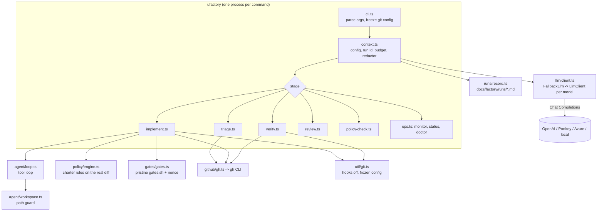
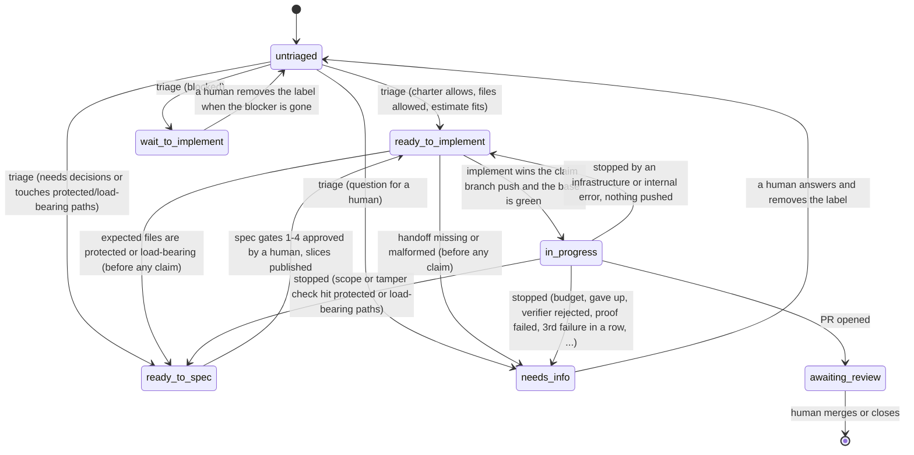
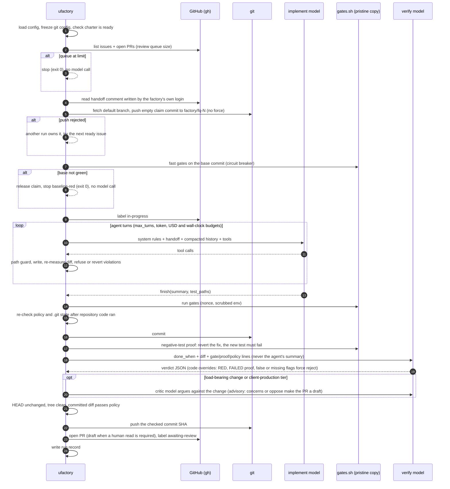

# How Ultimate Factory works at run time

This page follows one command from start to exit: which code runs, what each model sees, where
the checks sit, and what is written to disk and to GitHub. File references point at `src/`.

## Components

Each command is a short-lived process. There is no daemon and no database. State lives in
GitHub labels and comments, in Git branches, and in the run record each command writes.

## The issue lifecycle (labels)

## `ufactory implement --apply`, step by step

Every early exit takes the `catch` path in `implement.ts`. It releases an unpushed claim, moves
the issue to the right label, comments the reason, and writes the run record. SIGTERM and SIGINT
take the same path.

## What each model call contains

| Stage | System prompt | User content | Output | Size limit |
|---|---|---|---|---|
| triage | charter lists (automatable, needs-spec, never, load-bearing, limits) | issue + trusted comments, fenced | JSON disposition | 30k chars of issue text |
| implement | rules, tier, limits, contract (12k chars) | handoff + issue, fenced; then tool results | tool calls | 24k chars per tool result; results older than 6 turns become stubs |
| verify | verifier rules | done_when, files_expected, gate/proof/policy lines, fenced diff | JSON verdict | 120k chars of diff |
| critic | critic rules | same evidence as verify | JSON position | same |
| review (x10) | one persona's mandate and checklist | fenced diff, PR or files | JSON findings | 60k chars per persona |
| spec | one gate's instructions | issue + approved earlier gates | Markdown | none |

The implement agent does not receive the repository up front. It asks for files with `list_files`,
`search` and `read_file` (`agent.max_file_bytes`, default 20,000 characters per read, paged by
line), so context grows only with what it reads. File contents, test and gate output reach the model
inside the run's fence. Tool results larger than 400 characters and older than 6 turns are replaced
by stubs; the agent's own earlier messages are kept. The system prompt and first user message stay
identical across turns, so providers that cache prompt prefixes (OpenAI does this automatically
above 1,024 tokens) can bill that part at the cached rate; the run record reports list-price cost
and does not subtract cache discounts.

## Where the safety checks sit

| Moment | Check | Code |
|---|---|---|
| Before any model call | charter ready, review queue below limit, clean tree, daily cap | `implement.ts` |
| Before the claim | expected files are not protected or load-bearing | `checkScope` |
| Every write | path guard, existing tests untouchable, diff line/file limits | `workspace.ts`, handler |
| After any repository code runs | policy on the working tree, `.git` config/info/replace digest | `tamperCheck` |
| At finish | gates GREEN (one retry), nonce + exit code agree | `gates.ts` |
| After commit | proof PROVEN, tree still clean | `runProof` |
| Before push | HEAD is the checked commit, committed diff passes policy | publish block |
| On every PR | `policy-check` required status, no secrets | `factory-policy.yml` |

## Model selection at run time

`ctx.llm(role)` resolves the role's model from `factory.config.yaml` (default, profile, role,
persona) and builds one `FallbackLlm` per role and persona for the whole command: the primary model
followed by its `fallbacks`. Each model retries its own transient errors (429, 5xx, timeouts) with
backoff. If it still fails, the next model in the chain takes over and stays in use for that role
until the command ends. The run record lists every requested model and the model each provider
reported it served. Writer and verifier count as independent only if their chains share no model
and the providers served different models.
